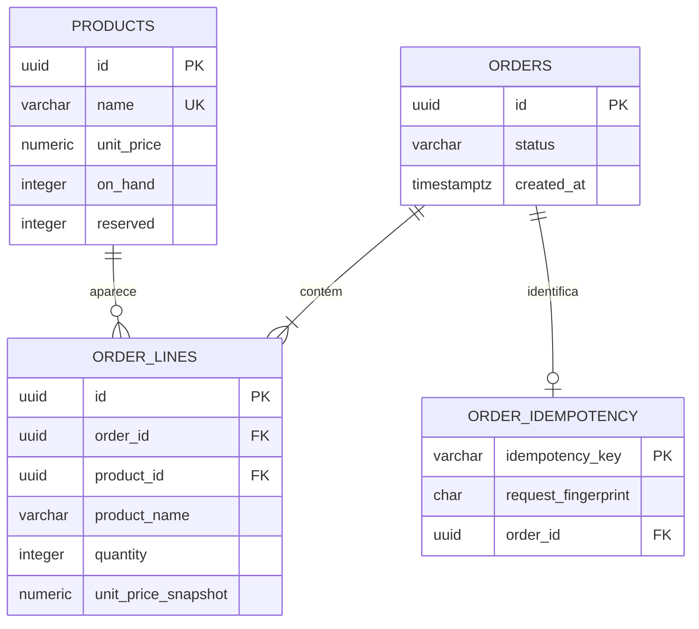
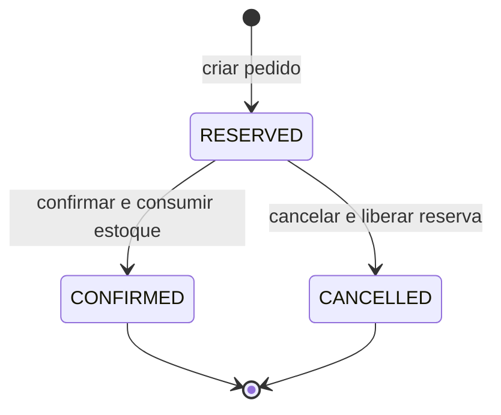

# Explicação do projeto: estoque e pedidos

Neste arquivo registrei como montei a API de estoque e pedidos, o que acontece em cada transação e por que usei bloqueios no PostgreSQL. Os exemplos de requisição estão em docs/API.md.

## O que eu implementei

Implementei cadastro e consulta de produtos, criação de pedidos com reserva de estoque, consulta do pedido, confirmação e cancelamento. Também implementei Idempotency-Key para uma repetição com o mesmo conteúdo devolver o pedido original. Consegui compilar o código; ainda não executei o fluxo contra um PostgreSQL neste ambiente.

## Como organizei os arquivos

```text
02-controle-estoque-pedidos/
├── docs/
│   ├── API.md
│   └── GUIA_DE_ESTUDO.md
├── src/main/java/br/com/portfolio/estoque/
│   ├── EstoqueApplication.java
│   ├── OrderController.java
│   ├── OrderDtos.java
│   ├── OrderService.java
│   └── ApiExceptionHandler.java
├── src/main/resources/
│   ├── application.properties
│   └── db/migration/V1__schema_inicial.sql
├── compose.yaml
├── pom.xml
└── README.md
```

OrderController declara as rotas, OrderDtos valida os corpos e representa as respostas, e OrderService contém as consultas e as transações. A migração SQL registra as regras que também precisam ser verdadeiras no banco.

## Modelo de dados que usei



Eu separo a quantidade física (`on_hand`) da quantidade reservada (`reserved`). O que pode ser comprado é `on_hand - reserved`. O banco impede valores negativos e também impede `reserved` maior que `on_hand`.

## Como eu reservo o estoque

1. Eu ordeno os produtos do pedido por UUID.
2. Dentro de uma transação, faço SELECT FOR UPDATE para bloquear cada linha de produto.
3. Confiro se todos têm unidades disponíveis.
4. Insiro o pedido e suas linhas e aumento reserved.
5. Ao final, o commit confirma todas as alterações juntas. Se uma regra falhar, a transação é revertida por inteiro.

Com duas requisições tentando comprar a última unidade, uma obtém o bloqueio primeiro. A segunda aguarda e só decide depois que a primeira confirma ou reverte. Assim, a decisão usa o estoque protegido pela transação.

Eu bloqueio produtos em ordem estável para reduzir a chance de deadlock quando pedidos diferentes incluem os mesmos produtos em ordens diferentes.

## Como implementei a idempotência

POST /api/orders exige Idempotency-Key. Eu ordeno as linhas, monto uma representação consistente do conteúdo e calculo SHA-256. A tabela order_idempotency tem uma chave primária única, e o INSERT ON CONFLICT DO NOTHING decide qual requisição processa a chave.

- Mesma chave e mesmo conteúdo: devolvo o mesmo pedido.
- Mesma chave e outro conteúdo: retorno conflito HTTP 409.
- Chave nova: crio pedido, reserva e registro idempotente na mesma transação.

Isso cobre o caso em que o cliente não recebe uma resposta e envia novamente a mesma solicitação.

## Preço congelado e estados

Eu copio o nome e o preço atual para order_lines quando crio o pedido. Se o catálogo mudar depois, o pedido antigo mantém o preço que foi usado naquele momento.



Confirmar diminui on_hand e reserved. Cancelar diminui apenas reserved. Repetir a confirmação de um pedido já confirmado, ou o cancelamento de um pedido já cancelado, retorna o estado atual sem aplicar o efeito outra vez. Não permito transições cruzadas.

## Decisões e limites que registrei

Para preços usei BigDecimal e NUMERIC(14,2), assumindo uma moeda única (BRL). Ainda não existe pagamento, autenticação, cliente do pedido, entrada de novas unidades ou expiração automática da reserva.

## Próximos passos que anotei

- Criar uma tabela stock_movements para auditar entrada e ajuste de estoque.
- Implementar expiração de reserva sem competir incorretamente com a confirmação.
- Registrar transições de estado e avaliar uma outbox transacional.
- Escrever testes de integração para disputa simultânea pelo último item e para reutilização da chave idempotente.

